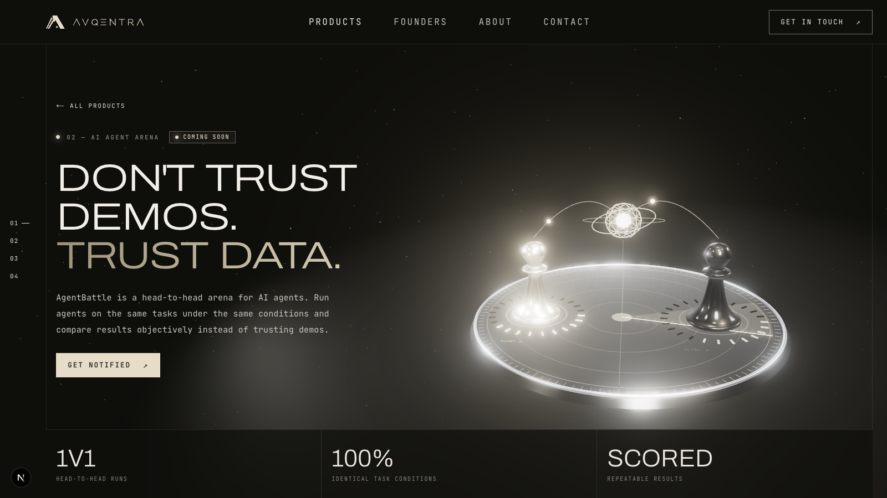
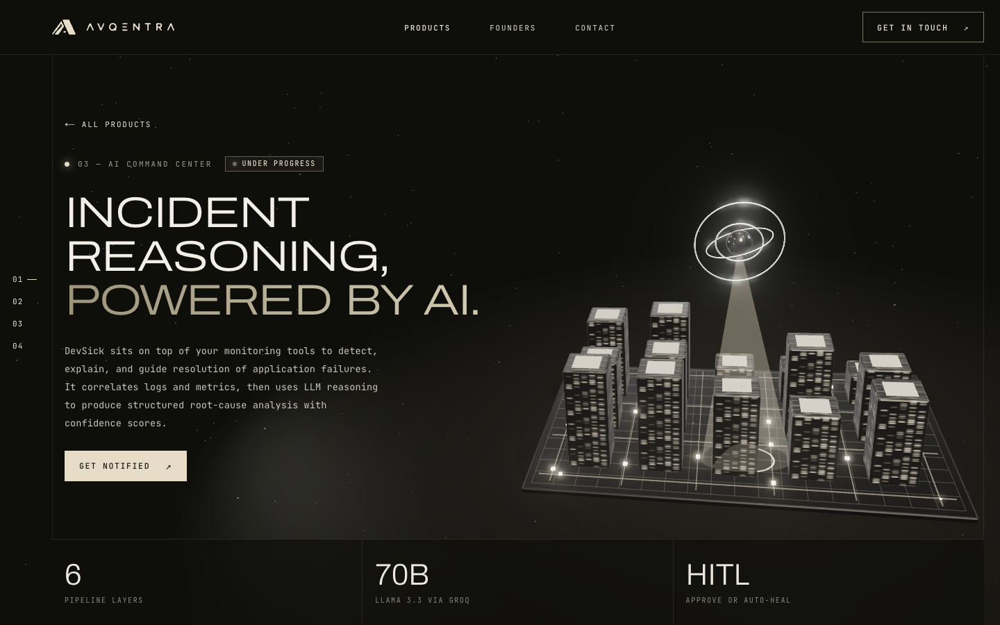
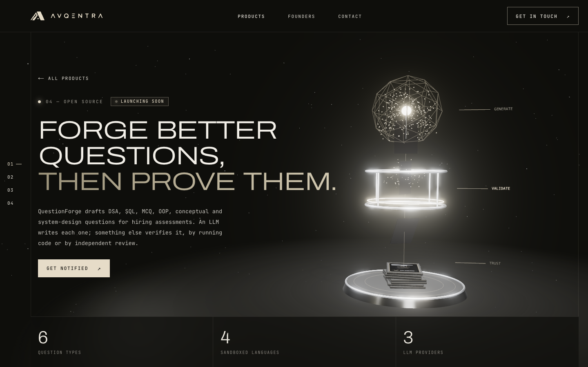
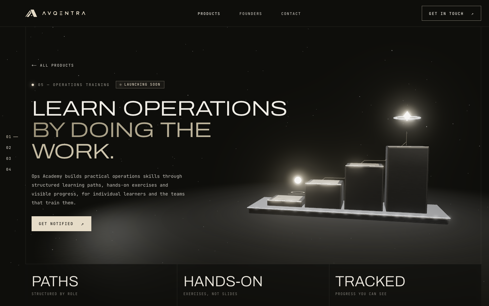
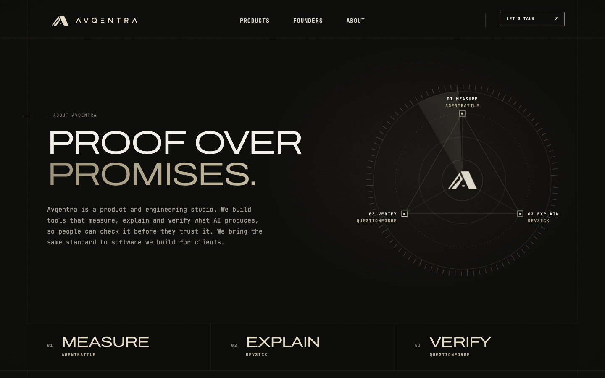
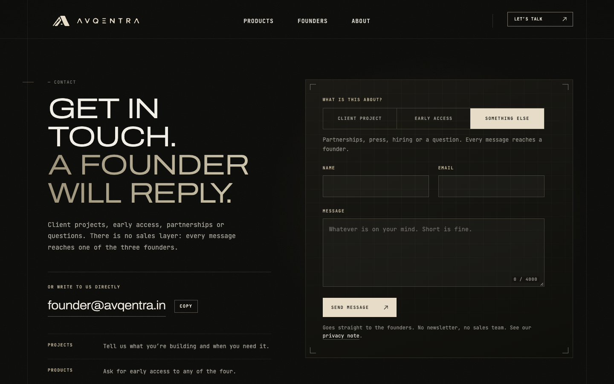

<div align="center">


### Ideas into tools.

**The official website of Avqentra, a product and engineering studio. Four products in development, and software built for clients.**


[Pages](#pages) · [Products](#the-products) · [Screenshots](#screenshots) · [3D engine](#the-3d-engine) · [Architecture](#architecture) · [Getting started](#getting-started) · [Contact form](#contact-form) · [Deployment](#deployment) · [Launch checklist](#launch-checklist)

</div>

---

## Overview

This repository contains the Avqentra marketing and product site. It explains what the studio is, introduces the founders and the four products, shows each product on its own page, and gives visitors a way to start a project or ask for early access.

The site is built around one design idea: **restrained, instrument-like, cream on black**. Fine lines, brushed metal, precise geometry, and motion that explains what a product does instead of decorating the page. [`DESIGN.md`](DESIGN.md) is the full reference for colour, type, layout, motion, accessibility and voice.

| | |
|---|---|
| **Framework** | Next.js 15 (App Router) · React 19 · TypeScript (strict) |
| **3D** | three.js with fully procedural scenes. No model files, no texture downloads |
| **Animation** | CSS for most motion; GSAP for the home intro and the gallery |
| **Styling** | Hand-written CSS and CSS Modules with design tokens. No UI framework, no runtime CSS-in-JS |
| **Fonts** | Archivo (extended width axis) and JetBrains Mono via `next/font`, self-hosted at build time |
| **Backend** | One API route (`/api/contact`) that stores contact messages in Supabase. Everything else is static |

## Pages

| Route | What it is |
|---|---|
| `/` | Home: intro animation, ecosystem of products, how we build, capabilities, "show the work", about, and a closing call to action |
| `/products` | Product index: a hero, a table of the four products, and a full section for each |
| `/products/agentbattle` `/devsick` `/questionforge` `/ops-academy` | Product pages, each with its own live 3D hero, how it works, capabilities, an interface mockup, tech stack and a link to the next product |
| `/about` | What Avqentra is: tools that **measure, explain and verify** AI. A flat blueprint diagram hero, how the products map to the three checks, two ways to work with us, four working rules, and the founders |
| `/founders` | Profiles, the founding story, an ownership matrix, and how to reach each founder |
| `/contact` | Contact form for client projects, early access and general messages, with `founder@avqentra.in` shown directly |
| `/privacy` | Plain-language privacy note: what the contact form collects and how to have it removed |
| `POST /api/contact` | Validates a message, stores it in Supabase and/or emails the founders |
| `/robots.txt` `/sitemap.xml` | Generated from the product list, so new products are included automatically |

## The products

| Product | What it is | Status |
|---|---|---|
| **AgentBattle** | A head-to-head arena for AI agents. Same tasks, same conditions, scored and repeatable results, so you compare agents on data instead of demos. | Launching soon |
| **DevSick** | An incident-intelligence layer that sits on top of your monitoring stack, detects failures, explains the root cause with LLM reasoning, and keeps a human in the loop for the fix. | In development |
| **QuestionForge** | Drafts technical interview questions with an LLM, then verifies them by running code or independent review before a human ever sees them. | Launching soon |
| **Ops Academy** | A learning platform that builds practical operations skills through structured paths, hands-on exercises and visible progress. | Launching soon |

Status values live in one place, `lib/products.ts` (`In development`, `Launching soon`, `Early access`, `Live`). Change a product's status there and every page, card and label updates.

## Screenshots

<table>
  <tr>
    <td width="33%"></td>
    <td width="33%"></td>
    <td width="33%"></td>
  </tr>
  <tr>
    <td align="center"><b>AgentBattle</b><br/>Two identical pieces, two materials, one score.</td>
    <td align="center"><b>DevSick</b><br/>A sentinel eye locks onto the failing service.</td>
    <td align="center"><b>QuestionForge</b><br/>Generate. Validate. Trust.</td>
  </tr>
  <tr>
    <td width="33%"></td>
    <td width="33%"></td>
    <td width="33%"></td>
  </tr>
  <tr>
    <td align="center"><b>Ops Academy</b><br/>Four modules, climbed one at a time.</td>
    <td align="center"><b>About</b><br/>Measure. Explain. Verify.</td>
    <td align="center"><b>Contact</b><br/>A founder will reply.</td>
  </tr>
</table>

## The 3D engine

The four product heroes are built procedurally in code: geometry, materials, textures (drawn on canvas), labels, and animation. There are **no `.glb` files and no image textures to download**, which keeps the payload small and every scene fully themeable.

**Scenes**

- **AgentBattle** is an arena: a brushed-metal turntable with an engraved degree scale, two lathed chess-piece silhouettes (cream chrome versus smoked black), score collars, a radar sweep, and a scoring core that leans toward the round's winner.
- **DevSick** is a city of lit-window towers on a street grid with data packets in flight, watched by a gimbal-ring sentinel eye. On a 12-second loop one tower fails, the eye locks on, and a root-cause panel appears before the system resolves.
- **QuestionForge** is a vertical pipeline: a draft cloud, a validation chamber with a scan ring, and a stack of verified documents. Cards are checked as they pass through.
- **Ops Academy** is a learning path: four modules climbed one at a time by a learner orb.
- **Home / products mark** is a particle cloud that condenses into the Avqentra mark and disperses again.

The About hero is deliberately **not** WebGL. It is a flat SVG and CSS blueprint diagram, so it costs almost nothing and works everywhere.

**Rendering and realism**

- ACES filmic tone mapping, HDR environment reflections (`RoomEnvironment` through PMREM), and MSAA through a half-float render target
- Soft PCF shadow maps from a single key light, so every object is grounded on its surface
- Procedural brushed-metal roughness maps, clearcoat, and rounded high-segment geometry for smooth edges
- Selective bloom for the glowing instrument elements

**Performance and accessibility**

- **Adaptive resolution:** a frame-time monitor trims or restores the pixel ratio automatically (between 1× and 1.75×) to hold a steady frame rate
- **Pauses off-screen:** an `IntersectionObserver` stops rendering when a scene is not visible, and rendering also stops when the tab is hidden
- **Smoothed timestep:** animation is frame-rate independent and blended against a running average so a single late frame never causes a jolt
- **`prefers-reduced-motion`** is respected: motion is stopped while the static composition stays
- **Graceful fallback:** if WebGL is unavailable, the scene silently does not mount and the page remains fully usable
- **Client-only:** three.js is loaded with `next/dynamic` (`ssr: false`) after the page is interactive, and every geometry, material and texture is disposed on unmount

## Architecture

```
app/
  layout.tsx              Root layout: fonts, cursor, legacy nav, footer
  page.tsx                Home
  about/ founders/        Themed pages (own SiteHeader)
  contact/ privacy/       Contact page (server component) + form, and the privacy note
  api/contact/route.ts    POST: validate, then store in Supabase and/or email the founders
  icon.png apple-icon.png favicon.ico   Browser and home-screen icons
  opengraph-image.png twitter-image.png Social share images (1200x630)
  robots.ts sitemap.ts    Generated robots.txt and sitemap.xml
  products/
    page.tsx              Product index
    agentbattle/ devsick/ questionforge/ ops-academy/
    products.css          Styling for the product pages
components/
  home/                   Home sections, intro, site header, logo
  about/                  About page sections, hero diagram, figure plates
  founders/               Founders page sections
  contact/                ContactForm, CopyEmail, styles
  privacy/                Privacy page styles
  landing/                Interface mockups, tilt cards, section rail
  Scene.tsx               Lazy client-only wrapper for the 3D canvas
  Scene3D.tsx             Renderer, lights, shadows, bloom, camera, lifecycle
  three-enterprise.ts     The four product scene builders
  three-models.ts         Shared kit: materials, textures, sparks, floor, HUD panels
  ProductsLanding.tsx     /products page
  ProductDetail.tsx       Shared product page template
  Nav.tsx Footer.tsx Cursor.tsx
lib/
  products.ts             Single source of truth for product content and status
  founders.ts             Founder data
  contact.ts              Contact topics and validation, shared by browser and server
  leads.ts                Server only: stores a message in Supabase and/or emails the founders
  site.ts                 Site name, public URL and contact email
  fonts.ts                next/font configuration
docs/
  supabase.sql            Table definition for contact messages
  screenshots/            README imagery
.env.example              Environment variables to copy into .env.local
.nvmrc                    Node version for local development (22)
DESIGN.md                 Design system and voice rules
```

**Content is data-driven.** Add or edit a product in `lib/products.ts` and the index, the product pages, the cards, the labels and the sitemap all update. Product repository links are deliberately not shown anywhere on the site. A product that has a full redesigned page carries an extra `page` object (hero lines, stats, steps, features, stack), which the product pages read through `getPageProduct()`. Scene builders are selected by a `SceneVariant` and receive a shared `Ctx` (kit, root group, lights, tick list), so adding a new scene means writing one builder function.

## Design system

| Token | Value | Use |
|---|---|---|
| Background | `#0e0e0b` | Page |
| Surface | `#16150f` | Cards, panels |
| Text | `#ece8df` | Primary copy |
| Muted | `#8a877f` | Secondary copy, labels |
| Cream (accent) | `#e6dcc8` | The single accent, in UI and 3D |
| Alert | `#ff5a45` | Used only for the DevSick incident state |

Typography pairs **Archivo** at extended width for display with **JetBrains Mono** for labels and body, which gives the site its technical, instrument-panel character. The 3D scenes use the same cream so the canvas and the page read as one surface. Voice rules (products are "in development", never claim results they don't have) are in [`DESIGN.md`](DESIGN.md) section 9.

## Getting started

**Requirements:** Node.js 20.9 or newer (22 recommended; `nvm use` reads `.nvmrc`) and npm.

```bash
git clone <repository-url>
cd avqentra
npm ci
npm run dev
```

Open <http://localhost:3000>. The site runs without any environment variables. Only the contact form's delivery and the public site URL use them (see [Environment variables](#environment-variables)).

| Script | Purpose |
|---|---|
| `npm run dev` | Start the development server with hot reload |
| `npm run build` | Create an optimized production build |
| `npm start` | Serve the production build |
| `npx tsc --noEmit` | Type-check the project (strict mode) |

> **Tip:** do not run `npm run build` while `npm run dev` is running. Both write to `.next`, and the dev server can end up in a broken state. Stop the dev server first, or delete `.next` and restart. After pulling changes that add dependencies, run `npm ci` and restart.

## Contact form

The contact page (`/contact`) posts to `POST /api/contact`, which validates the message and delivers it through up to two channels: **Supabase** (a stored record) and **Resend** (an email to the founders). Both are optional. A message counts as delivered if at least one configured channel succeeds, so a database outage never loses a message that still reached the inbox. If neither is configured the visitor sees a prefilled "open in your email app" link and `founder@avqentra.in`, and keeps what they typed.

**Connect Supabase**

1. Create a Supabase project, open **SQL Editor**, and run [`docs/supabase.sql`](docs/supabase.sql). It creates `contact_messages` with Row Level Security on and no public policies.
2. Set `SUPABASE_URL` and `SUPABASE_SERVICE_ROLE_KEY` (Project Settings, API). New messages appear in **Table Editor, contact_messages**.

**Email the founders (optional)**

1. In Resend, verify a sending domain and create an API key.
2. Set `RESEND_API_KEY` and `RESEND_FROM` (an address on the verified domain). Notifications go to `founder@avqentra.in`, or to `CONTACT_NOTIFY_TO` if set, with the visitor's address as the reply-to.

**What the route does**

- Checks the request is from the same origin and under 20 kB
- Silently drops submissions that fill the hidden honeypot field
- Applies a basic per-IP rate limit (5 per 10 minutes)
- Validates every field with the same rules the browser uses (`lib/contact.ts`)
- Delivers the message, and returns `503` when nothing is configured so the form can show its fallback

**Notes**

- Secret keys are read only by `lib/leads.ts` on the server. They must never be prefixed `NEXT_PUBLIC_` or used in a client component.
- To use a different service (a CRM, a webhook), change `store` or `notify` in `lib/leads.ts`. The form and route don't change.
- The rate limiter is in memory, per server instance. On serverless hosting, add edge protection (Cloudflare Turnstile or a WAF rule) for real abuse resistance.
- The contact address is set once, in `lib/site.ts`.

## Environment variables

All optional. Copy `.env.example` to `.env.local` for local use, and set the same names on your host.

| Variable | Purpose |
|---|---|
| `NEXT_PUBLIC_SITE_URL` | Public address used for canonical links, the sitemap and share images. Defaults to `https://avqentra.in` |
| `SUPABASE_URL`, `SUPABASE_SERVICE_ROLE_KEY` | Store contact messages in Supabase (server only) |
| `RESEND_API_KEY`, `RESEND_FROM` | Email the founders when a message arrives (server only) |
| `CONTACT_NOTIFY_TO` | Where notifications go. Defaults to `founder@avqentra.in` |

## Quality and security

- **Strict TypeScript** across the codebase
- **Continuous integration** (`.github/workflows/ci.yml`) runs on every push and pull request to `main`, on Node 22:
  - **Secret scan** with Gitleaks across full git history
  - **Production build** with `npm ci` and `npm run build`
- **Security headers** on every response (`next.config.mjs`): a Content Security Policy that limits the site to its own origin, `Strict-Transport-Security`, `X-Frame-Options: DENY`, `X-Content-Type-Options`, a strict `Referrer-Policy` and a locked-down `Permissions-Policy`. The CSP and HSTS apply in production only, so local development is unaffected. If you add a third-party script, font or embed, allow it in the policy first
- Secrets exist only on the server. `.env` and `.env*.local` are git-ignored, and `.env.example` documents the variables
- No third-party scripts, analytics, cookies or trackers. The one thing stored in the browser is a session flag so the home intro plays once
- The contact form collects a name, an email address and a message, and the privacy note (the `/privacy` page) says so
- **Known audit findings:** `npm audit` reports two issues (one moderate, one high) that come from the PostCSS copy bundled inside Next.js. They affect build-time processing of untrusted CSS, which this site doesn't do, and the only fix is the Next.js 16 major upgrade. Plan that upgrade rather than forcing it

## Deployment

The site is a Next.js app with one API route, so it needs a Node.js runtime. It cannot be deployed as a purely static export. Building needs internet access, because `next/font` downloads the fonts once at build time and self-hosts them.

**Vercel (recommended)**

1. Import the repository in Vercel
2. Framework preset: **Next.js**. Build command `npm run build`. Output is detected automatically
3. Add the [environment variables](#environment-variables) you want to use
4. Assign the production domain and enable automatic deploys from `main`

**Self-hosted**

```bash
npm ci && npm run build && npm start   # serves on port 3000
```

Set the same environment variables, and put it behind a reverse proxy (nginx, Caddy) that terminates HTTPS, or build a container around `npm start`.

## Launch checklist

**Done in the code**

- [x] Favicon, app icon, and social share images (1200x630), with per-page titles on shared links
- [x] `robots.txt`, `sitemap.xml`, canonical links, and structured data for the organization
- [x] Security headers and a Content Security Policy
- [x] Privacy note, linked from the footer and the contact form
- [x] Contact delivery through Supabase and/or Resend, tested end to end against fake services
- [x] Node version pinned (`.nvmrc`, `engines`), and CI on the same version
- [x] Product repository links removed from the site

**Before pointing the production domain at this build**

- [ ] Create the Supabase project, run `docs/supabase.sql`, set the environment variables on the host, then send a real test message and confirm it lands in the table
- [ ] Verify a sending domain in Resend and set `RESEND_API_KEY` and `RESEND_FROM`, then confirm the email arrives
- [ ] Confirm `https://avqentra.in` is the final public address. If not, set `NEXT_PUBLIC_SITE_URL`
- [ ] Have the privacy note reviewed and adjusted to match how you actually handle messages
- [ ] Add a bot check such as Cloudflare Turnstile if spam appears (the form already has a honeypot, a same-origin check and a rate limit)
- [ ] Check the share image by pasting the live URL into LinkedIn's Post Inspector or WhatsApp
- [ ] Run Lighthouse on the live site and the product pages, and test on a real phone and in Safari and Firefox
- [ ] Verify the founder subdomains (`yash.`, `prabhav.`, `ishaan.avqentra.in`) resolve
- [ ] Confirm the product claims on each page (stats, tech stack, descriptions) are accurate and approved
- [ ] Plan the Next.js 16 upgrade to clear the remaining audit findings

## Roadmap

- [ ] Launch the four products and move their status to *Early access* and then *Live* in `lib/products.ts`
- [ ] Waitlist capture and launch notifications
- [ ] Per-product share images generated from the 3D scenes
- [ ] Lighter 3D tier for low-power devices
- [ ] Blog and changelog
- [ ] Automated visual regression tests for the hero scenes

## Team

| | Role | |
|---|---|---|
| **Yash Srivastava** | Chief Executive Officer | yash.avqentra.in |
| **Prabhav Singh** | Chief Technology Officer | prabhav.avqentra.in |
| **Ishaan Bajpai** | Chief Financial Officer | ishaan.avqentra.in |

Contact: [founder@avqentra.in](mailto:founder@avqentra.in)

## Contributing

This is a company website, so changes are made by the Avqentra team.

1. Branch from `main` (`feat/<topic>` or `fix/<topic>`)
2. Keep changes focused, and run `npx tsc --noEmit` and `npm run build` before opening a pull request
3. Match the surrounding code's naming, comment density and idiom, and follow [`DESIGN.md`](DESIGN.md)
4. Open a pull request into `main`. CI must pass (secret scan and build) before merge

Never commit secrets. The Gitleaks scan will fail the build if it finds any.

## License

Copyright © Avqentra. All rights reserved. This source is proprietary and is not licensed for reuse or redistribution without written permission.

---

<div align="center">
<sub>Built by Avqentra · Ideas into tools.</sub>
</div>
